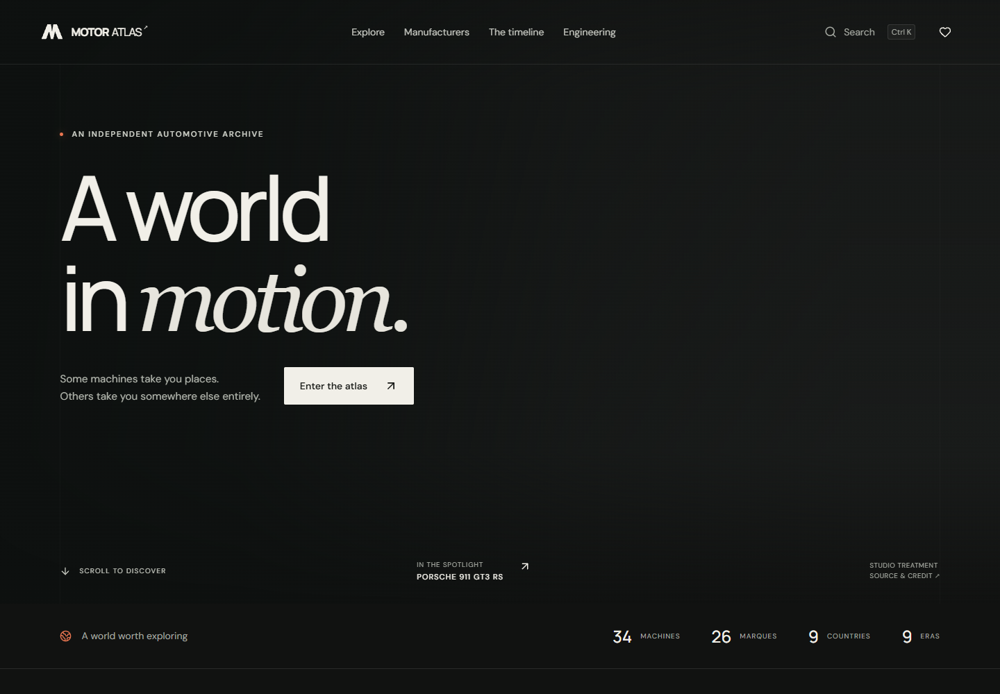

# Motor Atlas

A local automotive museum and discovery platform, built in `D:\Car`. Explore machines, their engineering, and the people and eras behind them.



## Run locally

Use Node.js 22.12+ and npm. Dependencies are already installed in this workspace.

```powershell
cd D:\Car
npm install
npm run dev
```

Open **http://127.0.0.1:5173/**. The server binds to the loopback interface. No accounts, API keys, backend, or external runtime services are required. Nothing has been deployed.

```powershell
npm run build
npm run preview
```

The production preview uses http://127.0.0.1:4173/. Vite handles direct route refreshes locally. An eventual static server must rewrite application routes to `index.html`.

## The experience

- Cinematic studio hero, original SVG identity, editorial typography, restrained Motion transitions, responsive navigation, and reduced-motion support.
- A vehicle explorer with URL-backed search and filters: manufacturer, country, model, generation, era, body, category, powertrain, engine configuration, aspiration, layout, drivetrain, transmission, seats, doors, and performance limits. Sort and switch between grid and list views.
- Global **Ctrl K / ⌘ K** command search across cars, brands, generations, countries, and categories. Arrow keys select; Enter opens; Escape dismisses.
- Manufacturer, country, model, and generation exhibits; vehicle stories, specifications, source context, lineage, related cars, licensed galleries, fullscreen viewing, zoom, and keyboard navigation.
- Compare up to four cars, highlight differing values, switch hp/kW, retain measurement standards, and share the comparison URL.
- Local favorites and comparison persistence, curated metadata-based collections, deterministic daily discovery in Asia/Dhaka, and random discovery.
- Historical timeline, engineering topics, automotive glossary, and statistics calculated from the actual local dataset.
- An optional, lazy-loaded Three.js wheel study with orbit, zoom, reset, and rotation controls. It is explicitly an abstract exhibit. The renderer also supports a future licensed GLB vehicle asset.
- A small secret passage: search for **open road** in the global command palette.

## Stack and decisions

React 19, TypeScript, Vite, React Router, Motion, Three.js, Lucide, and Zod. CSS tokens and reusable components provide a maintainable design system. DM Sans and Manrope are served locally.

A client-side React application suits the requested local, static archive. There is no server or database to maintain without an account or editing requirement. Explicit typed entities form the data boundary; storage and discovery logic are separate from page components. Most routes are lazy-loaded, and the 3D bundle loads only when the visitor opens the workshop. The initial image loads eagerly; gallery/card images use local optimized WebP assets with lightweight thumbnails and graceful fallbacks.

## Dataset

The initial archive contains **34 variants, 30 model families, 34 generations, 26 manufacturers, and 9 countries**, from 1908 to 2024. It is a curated starting collection, with classic, performance, utility, hybrid, and electric vehicles. It does not claim to index every model or market.

The hierarchy is **Country → Manufacturer → Model → Generation → Vehicle variant**. Numerical unknowns remain `null`; hp is converted from kW; dry, DIN, and curb weights retain context. Primary manufacturer references are attached to every vehicle. Checked dates mean review of a core reference, not independent verification of every field. Photographs have their own credits and licensing records; pictured trims or years can differ from the indexed specification.

See [data authoring](docs/DATA.md), [architecture](docs/ARCHITECTURE.md), [design system](docs/DESIGN.md), [media provenance](docs/MEDIA.md), and [photo attributions](docs/ATTRIBUTIONS.md).

## Validation

```powershell
npm run lint
npm test
npm run data:validate
npm run build
npx playwright install chromium
npm run test:e2e
```

If Chromium is not installed but Google Chrome is available:

```powershell
$env:PLAYWRIGHT_CHANNEL = 'chrome'
npm run test:e2e
```

The browser tests use software graphics for reliable headless WebGL testing. They do not alter the app browser's graphics settings. Browser journeys cover filters and direct refresh, favorites, comparison, keyboard search, gallery focus, 3D controls, media/WebGL failure, navigation, responsive overflow, and axe checks. See [QA details and screenshots](docs/QA.md).

Useful maintenance commands:

```powershell
npm run data:import -- path/to/vehicles.json --dry-run
npm run data:import -- path/to/vehicles.json
npm run media:sync
npm run data:sources
npm run docs:credits
npm run qa:screenshots
npm run format
```

Source/media refresh commands need an internet connection; ordinary application use does not.

## Current limits and next steps

The dataset is curated and many historic measurements are unavailable. Most galleries have one photograph; three featured cars have additional views. There are no licensed vehicle-specific 3D meshes yet. Favorites belong to the browser and origin, with no cloud synchronization. Titles and descriptions update in the browser, but server rendering, dynamic social-preview metadata, and a complete multilingual encyclopedia are future work.

The strongest next improvements are independently auditing each specification and market, expanding generation/variant coverage, obtaining exact-trim photography and licensed GLB models, then adding prerendering and richer accessible charts. Add a backend only when an actual editorial or account workflow requires one.
